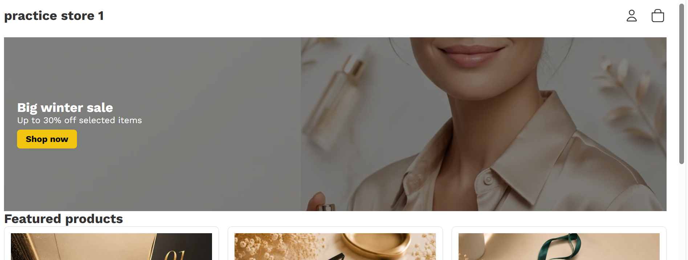
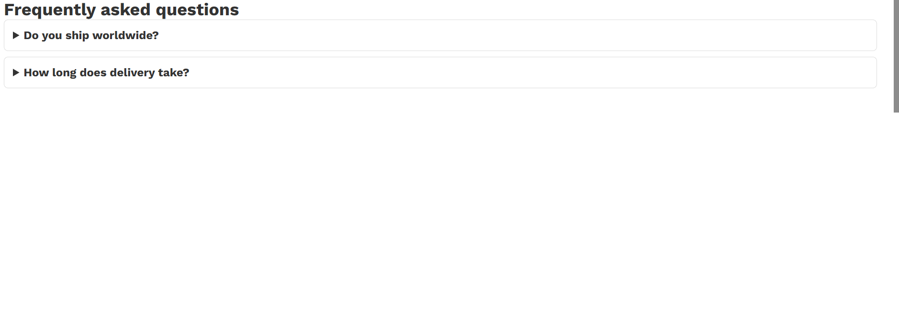
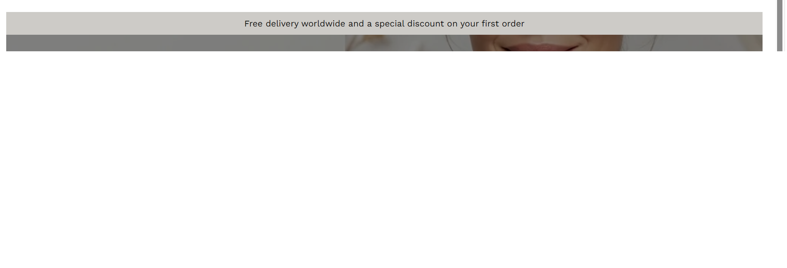

# Nyurexa Practice Theme

A Shopify theme project built to practice Liquid, JavaScript and CSS.

> Practice project. Product names and images are placeholders. I built the Banner, Featured products and FAQ and Announcement bar sections. The rest of the theme comes from Shopify's starter theme.

## Sections
- **Banner:** image, heading and yellow button, edited in the theme editor.
- **Featured products:** product cards with images, price, Material and Origin, and a View product button.
- **FAQ:** questions the owner can add and edit.
- **Announcement bar:** top bar with editable text, color and on/off switch.

## Built with
Liquid, JavaScript, CSS (grid and media queries), Shopify CLI.

## Screenshots

## Contact
- Muhammad Ahmad, Shopify developer, Pakistan 
- Email: ohmmedahmed18@gmail.com
- WhatsApp: 0300 22 11460
