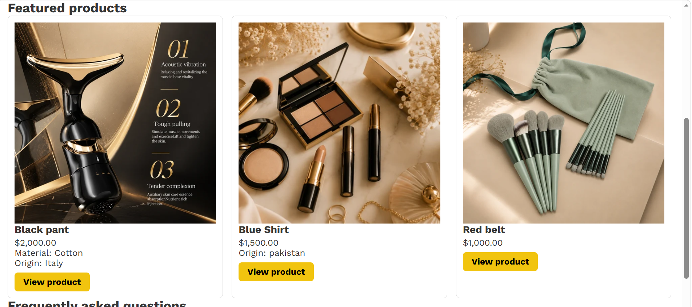

# Nyurexa Practice Theme

A Shopify theme project built to practise Liquid, JavaScript and CSS.

## Sections
- **Banner:** image, heading and yellow button, edited in the theme editor.
- **Featured products:** product cards with images, price, Material and Origin, and a View product button.
- **FAQ:** questions the owner can add and edit.

## Built with
Liquid, JavaScript, CSS (grid and media queries), Shopify CLI.

## Screenshots

